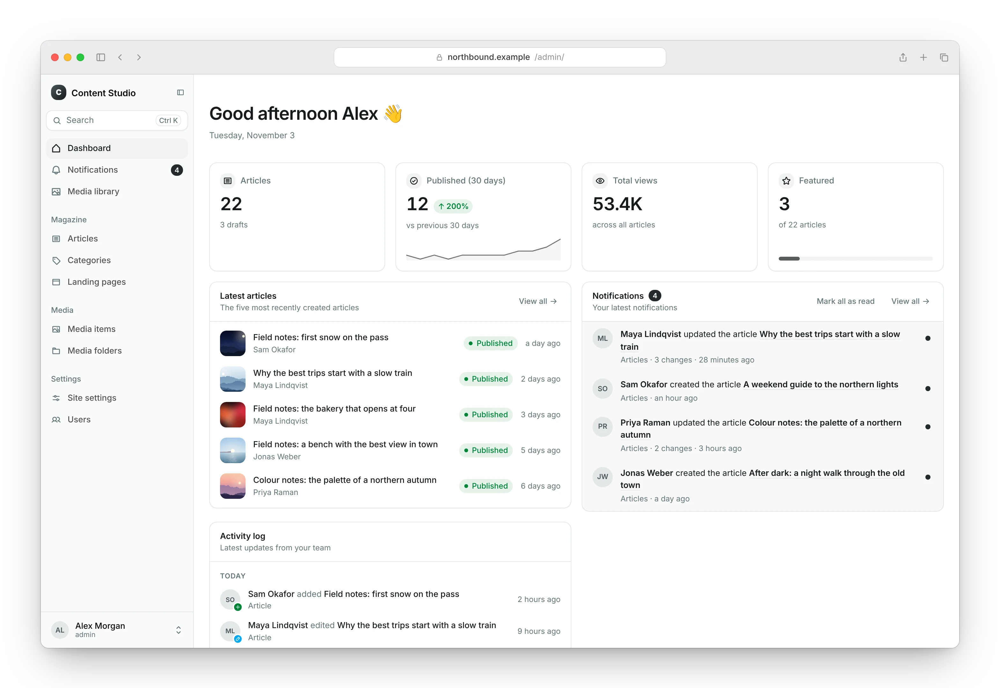

<p align="center">
  
</p>

<h1 align="center">DjangoStack</h1>

<p align="center">
  <a href="https://www.npmjs.com/package/@django-stack/cli"></a>
  <a href="https://pypi.org/project/django-stack/"></a>
  <a href="https://pypi.org/project/django-stack/"></a>
  <a href="https://pypi.org/project/django-stack/"></a>
  <a href="https://github.com/dwarsbit/django-stack/actions/workflows/ci.yml"></a>
  <a href="LICENSE"></a>
</p>

<p align="center">
  <strong>Developer-first Django tooling</strong><br>
  The production-ready Django, batteries included stack.
</p>

DjangoStack creates a website project with a Django backend, a frontend,
Postgres and Umami analytics (Valkey if you want it), run by Docker Compose.
[Django Headless](https://djangoheadless.org) serves the content API and
[Django Content Studio](https://djangocontentstudio.org) is the admin. The
`dstack` command takes the project from development to deploy.

<p align="center"><strong>Documentation: <a href="https://dwarsbit.github.io/django-stack/">dwarsbit.github.io/django-stack</a></strong></p>

<picture>
  <source media="(prefers-color-scheme: dark)" srcset="website/static/img/screenshots/dashboard-dark.webp">
  
</picture>

## Features

- **One command**: `init` asks for the frontend, the database and demo
  content, and writes a project with fresh secrets. Every prompt has a
  flag, so it also runs in scripts.
- **Your choice of frontend**: Astro, Next.js, SvelteKit or Nuxt.
- **Your content model**: pages, posts, menus and site settings as
  ordinary Django models in your project.
- **An admin for editors**: Django Content Studio, with drafts, a media
  library and a preview of a draft on the site.
- **Closed by default**: the API needs a key for every request, and the
  frontend gets the read-only key only, on the server.
- **Production on your server**: the same `compose.yaml` runs behind Caddy
  with HTTPS, read-only containers without privileges and daily backups.
- **Deploy with one command**: `dstack deploy` puts the project on
  Coolify, Dokploy, Bunny Magic Containers or a server over SSH.
- **Open pieces**: Django, Django Headless, Django Content Studio, Postgres,
  Valkey and Umami are open-source projects you can read, change or remove.

## Requirements

- Docker with Docker Compose v2
- Node.js 22 or later
- Python 3.12 or later, to work on the backend outside the containers

## Quick start

```bash
npm i -g @django-stack/cli
dstack init my-site
cd my-site
dstack dev
```

Then open http://localhost:3000 for the site and
http://localhost:3000/admin/ for the admin. Continue with
[Getting started](https://dwarsbit.github.io/django-stack/docs/getting-started)
in the documentation.

## Documentation

The full documentation is at [dwarsbit.github.io/django-stack](https://dwarsbit.github.io/django-stack/).
Good places to start:

- [Getting started](https://dwarsbit.github.io/django-stack/docs/getting-started): create a project and run it
- [CLI reference](https://dwarsbit.github.io/django-stack/docs/cli): every `dstack` command and flag
- [Content and the API](https://dwarsbit.github.io/django-stack/docs/content-api): the content model and how the frontend reads it
- [Deploy to a server](https://dwarsbit.github.io/django-stack/docs/production/server): production with Caddy, HTTPS and backups
- [Coolify and Dokploy](https://dwarsbit.github.io/django-stack/docs/production/platforms): deploy to a hosting platform

## This repository

| Path | Contents |
|------|----------|
| `packages/cli` | `@django-stack/cli`: the `dstack` command |
| `packages/utils` | `@django-stack/utils`: the API client, content helpers, SEO, images and webhook signatures |
| `packages/react` | `@django-stack/react`: React components |
| `packages/next` | `@django-stack/next`: Next.js glue |
| `packages/svelte` | `@django-stack/svelte`: Svelte components |
| `packages/vue` | `@django-stack/vue`: Vue components |
| `python/django-stack` | `django-stack` on PyPI: settings, API defaults, health checks, system checks, backups |
| `templates/` | The files `init` copies into a new project |
| `scripts/e2e.sh`, `scripts/e2e-prod.sh` | The end-to-end tests: create a project with the CLI and run it with Docker Compose, in development and in production |
| `website/` | The documentation site (Docusaurus) |

## Contributing and support

- Read [CONTRIBUTING.md](CONTRIBUTING.md) to set up the project and propose a change, and [AGENTS.md](AGENTS.md) for the layout and conventions.
- Report bugs in [GitHub Issues](https://github.com/dwarsbit/django-stack/issues).
- Report security problems privately; see [SECURITY.md](SECURITY.md).

## License

MIT; see [LICENSE](LICENSE). Changes are listed in the [changelog](CHANGELOG.md).
